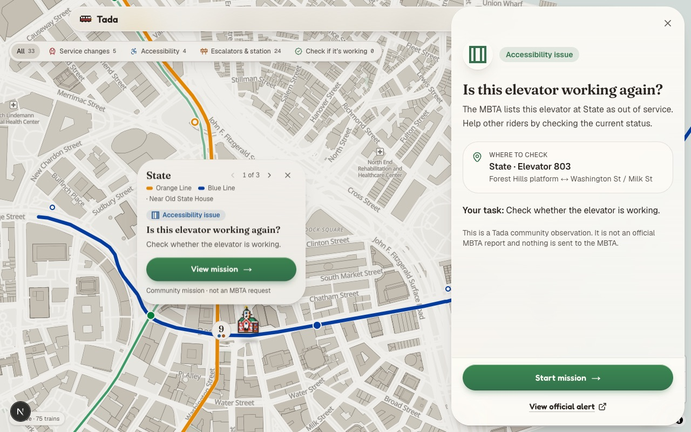

# Tada

**Live demo: https://bostonhacks-2026.vercel.app** · Built for BostonHacks 2026

Created and maintained by [Rachel Miao](https://github.com/Rachelmiao06), repository administrator.

Your elevator is out again. You tell nobody, because you don't know who to tell. The MBTA posts an alert, the city has a 311 site, and a rider's note usually lives in neither. Tada puts all of it on one map and turns a quick report into something you can see, check and feel good about.

You open a pixel map of the T, find a real problem near you, report it, check whether it's fixed, and watch a small knitted island grow with every real thing you do.



## What you can do

1. **Report a new problem.** Take a photo. Tada reads it, writes up a clear description, and opens the Boston 311 form with the text already filled in. It judges a photo by what it shows, so a picture of a screen still works.
2. **Help with a problem that is already there.** Every pin on the map is a real MBTA alert (elevator, escalator, station issue, closure, shuttle). Take a short three-step mission to add what you saw. Each rider can complete a mission once, so nobody can farm points.
3. **Follow what the city is doing.** Check whether an outage is still open or fixed. The map updates from live MBTA data, and Tada keeps its own record of when things got fixed.

Every real action adds a piece to **My World**, a knitted island. The look is warm and soft on purpose, so it feels like thanking you, not like a form.

## What is real and what is not

- The MBTA alerts and the Boston 311 history are real, live data.
- "Completed in Tada" does **not** mean the MBTA or the city received anything. Tada never sends a report for you. It opens the official form and you submit it yourself.
- Missions made by Tada are labelled unofficial. We never invent official campaigns or deadlines.
- The AI helps you write a clearer report. It never says a photo proves a fact.
- Demo mode (`?demo=1`) uses a fixed Boston spot and sample photos so the demo works without live data.

## How we built it

**MBTA API.** Live alerts become the pins on the map. We cache them for 5 minutes and fall back to a saved snapshot, so the demo never depends on the MBTA being up. A scheduled job (`.github/workflows/sync.yml`) refreshes every 5 minutes so fix times stay accurate when nobody is using the app.

**Boston 311 open data (data.boston.gov).** We query past 311 reports near a spot to warn about duplicates, and we open the 311 form with your description filled in. If the check can't run, the screen says so and never claims there are no duplicates.

**Gemini.** One model reads your photo and text and returns scores. A report passes when every score is 3 out of 5 or more. That rule lives in the server code, and only the review route can save an AI result, so neither the browser nor the model can grant a pass. We try a fast lite model first and fall back to bigger ones. Checks are capped at 20 per rider and 60 per network address per hour (the address is stored only as a hash).

**Tiger Data (Postgres).** Reports, verifications and the MBTA alert history live in one shared database. Rewards are counted from completed missions, not stored, so a rider can't earn the same one twice. Photos are never saved on the server, only a "has photo" flag. We loaded 26,300 closed outages from the MBTA's public alert archive to measure time-to-fix, and the stats page uses medians so a few multi-year outages don't skew the numbers.

**MapLibre and Three.js.** MapLibre draws the pixel map and the 3D world view, including Boston University landmarks. Three.js draws My World, adapted from [Yarn World by Kris Yang](https://github.com/krisyangdev/yarn-world) (MIT). We load the 3D code in parallel and the sounds after the island appears, cache assets for a day, and stop rebuilding the scene on every visit so it stays fast on phones.

**Next.js on Vercel.** The app and its server routes. API keys live only in server routes and in Vercel's settings.

## Run it on your laptop

```bash
npm install
npm run dev
```

Open http://localhost:3000. Copy `.env.example` to `.env.local` and fill in the keys you have. Only the database and Gemini keys are needed for the full flow. The MBTA key and the Google Places key are optional.

## Where things are

- `docs/SPEC.md`: what Tada is and is not.
- `docs/DECISIONS.md`: one line per decision, with the reason.
- `src/features/<name>/`: one folder per feature, each with its own README.
- `TEAM.md` and `CLAUDE.md`: how we worked together.
